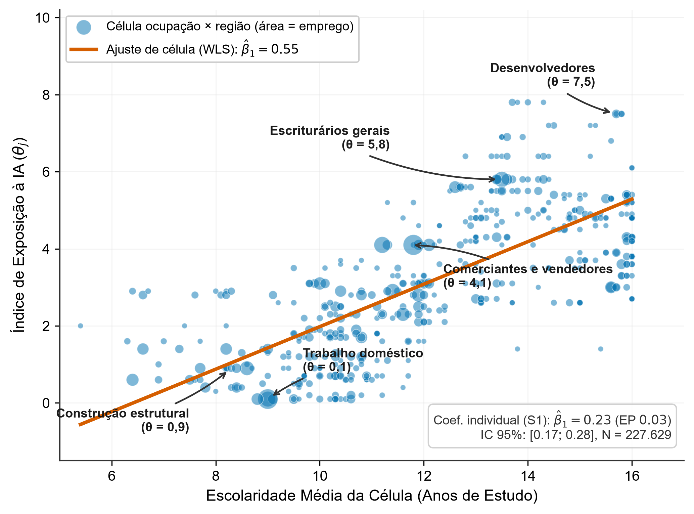
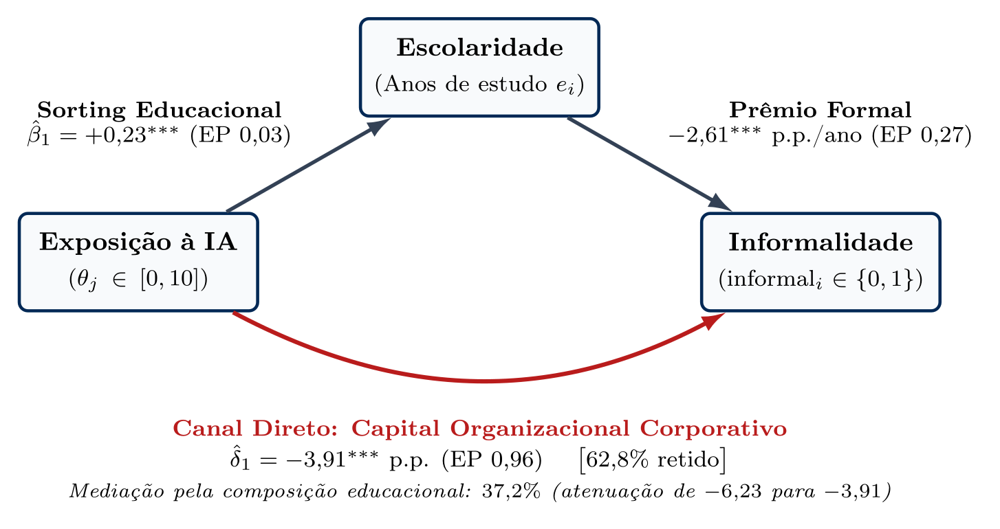
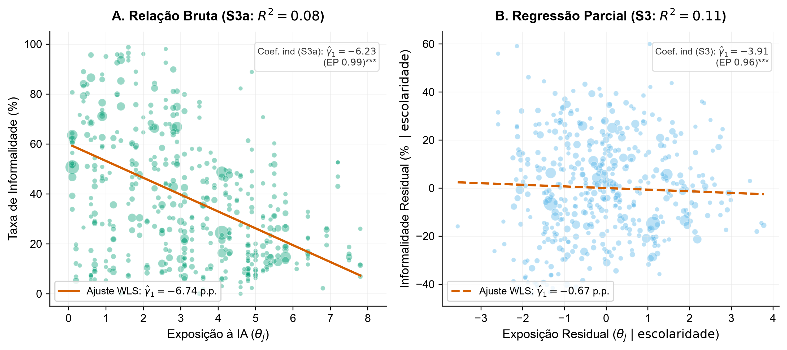
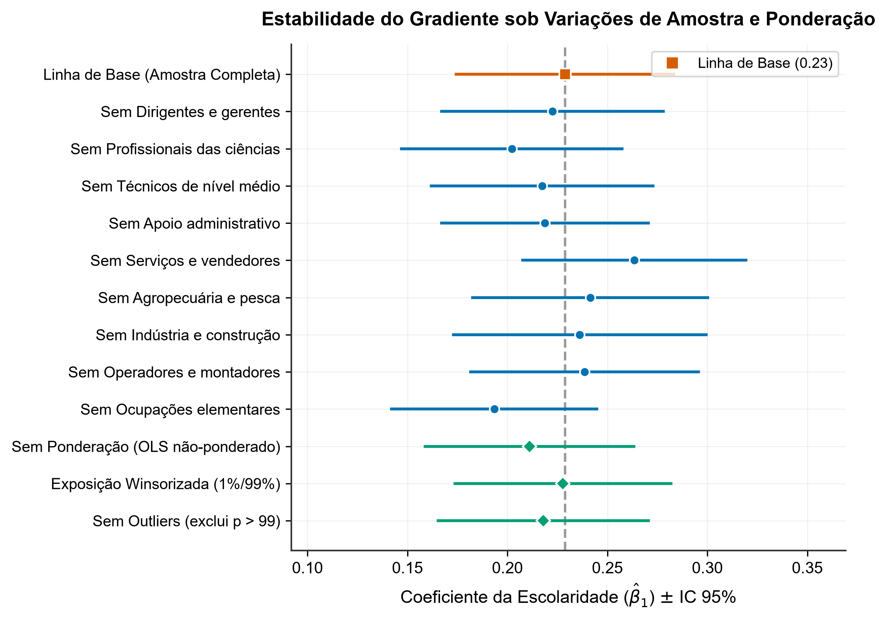
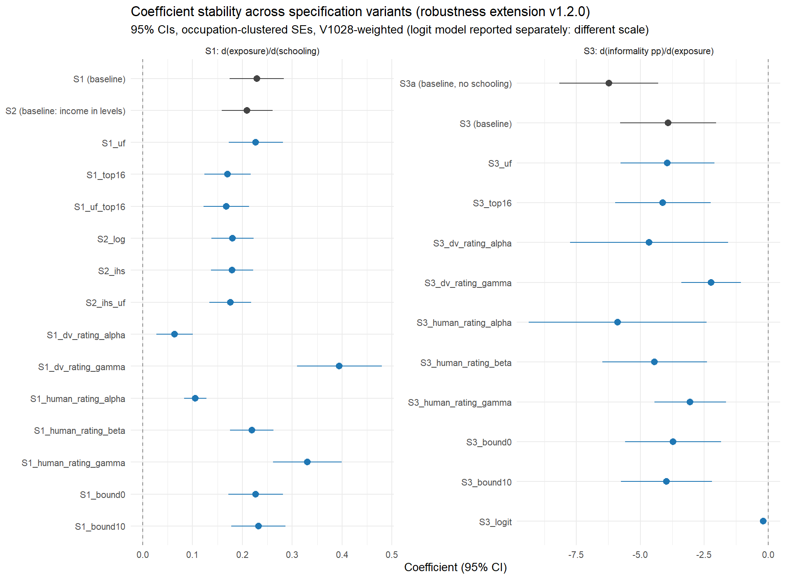
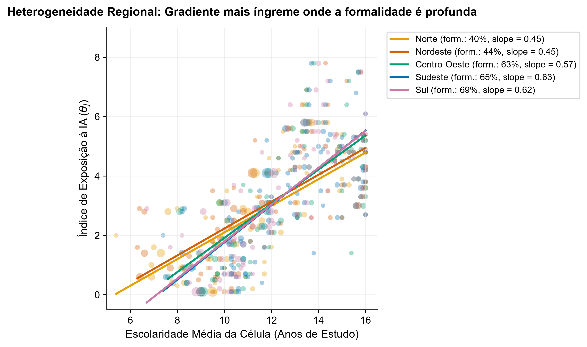

# {.sidebar width="300px"}

```{=html}
<div class="sidebar-author-box" aria-label="Identificação do autor">
  <span class="author-name">Marcelo Moura Freire</span>
  <span class="author-role">Economista · Universidade de Coimbra</span>
  <a href="mailto:marcelo.moura.freire@gmail.com" class="author-email" title="Contato por e-mail" aria-label="E-mail de contato: marcelo.moura.freire@gmail.com"><span aria-hidden="true">✉️ </span>marcelo.moura.freire@gmail.com</a>
</div>

<div class="filterbar" id="filterbar" role="toolbar" aria-label="Filtros globais vinculados">
  <div class="fgroup" role="group" aria-labelledby="flabel-reg">
    <span class="flabel" id="flabel-reg">Região</span>
    <span id="fRegions" class="fgroup"></span>
  </div>
  <div class="fgroup" role="group" aria-labelledby="flabel-form">
    <span class="flabel" id="flabel-form">Formalidade</span>
    <span id="fForms" class="fgroup"></span>
  </div>
  <div class="fgroup">
    <button id="fClear" class="btn-dash ghost" type="button" aria-label="Limpar todos os filtros" style="width:100%;justify-content:center">Limpar filtros</button>
  </div>
  <span id="activeCount" aria-live="polite">Carregando amostra…</span>
</div>

<p class="pnote" style="font-size:12px;margin-bottom:8px">
  <b>Filtros vinculados:</b> aplicam-se simultaneamente às estatísticas resumidas, distribuições, correlações, bolhas regionais e tabela de microdados (PNAD Contínua 2026Q1 · pesos V1028).
</p>

<div class="sidebar-links">
  <a href="./paper.pdf" class="btn-dash" target="_blank" rel="noopener"><span aria-hidden="true">📄 </span>Artigo Completo (PDF)</a>
  <a href="https://github.com/coach-sarmelo/exposicao-ia-trabalho-informal-brasil" class="btn-dash ghost" target="_blank" rel="noopener"><span aria-hidden="true">💻 </span>Código no GitHub</a>
  <a href="https://www.linkedin.com/in/marcelomfreire" class="btn-dash ghost" target="_blank" rel="noopener"><span aria-hidden="true">🔗 </span>LinkedIn</a>
</div>
```

# Visão Geral

## Row

::: {.valuebox icon="people" color="primary"}
Trabalhadores Analisados

227.629

Amostra com escore válido (228.325 total)
:::

::: {.valuebox icon="briefcase" color="info"}
Grupamentos Ocupacionais

122

Grupos COD-IBGE (127 na amostra bruta)
:::

::: {.valuebox icon="graph-up-arrow" color="primary"}
Gradiente Educacional (S1)

β = +0,23***

p < 0,001 · EP clusterizado: 0,028
:::

::: {.valuebox icon="shield-check" color="success"}
Barreira da Informalidade (S3)

62,8% Direto

37,2% mediado por escolaridade
:::

## Row

::: {.card title="1 · Estatísticas Resumidas Dinâmicas (Amostra Filtrada)"}
::: {.pnote}
Cartões e tabela descritiva recalculados em tempo real sobre o subconjunto ativo nos filtros globais da barra lateral. Médias, desvios-padrão e quantis ponderados pelos pesos amostrais oficiais (V1028); a linha de exposição considera ocupações com escore válido.
:::

```{=html}
<a href="#mainContent" class="skip-link">Pular para o conteúdo principal</a>
<main id="mainContent" tabindex="-1">
  <div id="kpiRow" class="kpis"></div>
  <div class="tscroll" tabindex="0" role="region" aria-label="Tabela de estatísticas descritivas ponderadas">
    <table id="descTable"></table>
  </div>
</main>
```
:::

## Row

### Column {width=55%}

::: {.card title="Síntese da Pesquisa & Contexto Teórico"}
#### Exposição à Inteligência Artificial em um Mercado de Trabalho Informal: Teoria e Evidências para o Brasil

Em que medida o mercado de trabalho brasileiro está efetivamente exposto à inteligência artificial generativa e quem são os trabalhadores mais atingidos? Este estudo desenvolve um **modelo de designação de tarefas (*task assignment model*)** com adoção dual de IA (individual e corporativa) sob informalidade contratual, testando suas previsões sobre **228.325 observações individuais** da PNAD Contínua (IBGE, 2026Q1) cruzadas com o índice de exposição ocupacional de Eloundou et al. (2024).

::: {.callout-tip title="Principais Achados Empíricos"}
- **Gradiente Educacional Positivo:** Cada ano adicional de estudo associa-se a **+0,23 ponto** de exposição à IA ($\text{EP} = 0{,}028, p < 0{,}001$) em regressões WLS com controles mincerianos completos.
- **Mediação da Informalidade:** O diferencial bruto de informalidade sobre exposição ($-6{,}23$ p.p. em S3a) atenua-se em **37,2%** após controle por escolaridade, preservando **62,8%** ($-3{,}91$ p.p. em S3) como efeito direto do capital organizacional formal.
- **Robustez de Oster (2019):** A razão de seleção em não-observáveis atinge **$\delta = 1{,}93 > 1{,}00$** ($\beta^* = +0{,}10$ sob $\delta = 1$), descartando viés de variáveis omitidas.
- **Polarização Regional:** A profundidade da formalidade estadual amplifica o retorno educacional à exposição tecnológica (interação $+0{,}28^{***}$), com limiar crítico em **$e^* = 11{,}14$ anos de estudo**.
:::

**Classificação JEL:** J23 · J24 · O33 · O17 · J46
:::

### Column {width=45%}

::: {.card title="Gradiente Educacional de Exposição à IA (Figura 1)"}


*Figura 1: Escore médio de exposição à IA (0–10) por anos de estudo concluídos com intervalos de confiança de 95%. Tamanho dos círculos proporcional à população ocupada estimada (pesos V1028). Fonte: PNAD Contínua 2026Q1 (N = 227.629).*
:::


# Distribuições & Gradientes

## Row

::: {.card title="2 · Distribuições-Chave (Ponderadas pelos Pesos Amostrais V1028)"}
::: {.pnote}
Histogramas ponderados pelos pesos amostrais (V1028) da PNAD Contínua 2026Q1 sob os filtros ativos. Alterne o eixo vertical entre proporção da força de trabalho (%) e contingente populacional estimado (milhões).
:::

```{=html}
<div class="tools">
  <label for="histMode">Eixo y dos histogramas</label>
  <select id="histMode" aria-label="Eixo y dos histogramas">
    <option value="pct">% da população estimada</option>
    <option value="abs">População estimada (milhões)</option>
  </select>
</div>
<div class="hgrid">
  <figure class="fig"><div class="ph"><b>2a · Exposição à IA</b><span id="sub-hist"></span></div><div id="histExpo" class="plot"></div></figure>
  <figure class="fig"><div class="ph"><b>2b · Escolaridade</b><span>anos completos de estudo (0 a 16+)</span></div><div id="histEdu" class="plot"></div></figure>
  <figure class="fig"><div class="ph"><b>2c · Idade</b><span>faixas etárias da força de trabalho ocupada</span></div><div id="histAge" class="plot"></div></figure>
  <figure class="fig"><div class="ph"><b>2d · Rendimento mensal habitual</b><span>escala logarítmica: faixas estreitas em rendas baixas; largura visual proporcional ao intervalo do log</span></div><div id="histInc" class="plot"></div></figure>
</div>
```
:::

## Row

::: {.card title="3 · Correlações e Gradientes Ocupacionais"}
::: {.pnote}
Dispersões individuais (amostra determinística de até 4.000 pontos via hash estável) com linha de tendência calculada sobre **todos** os indivíduos filtrados (médias ponderadas exatas). Correlações de Pearson ponderadas. Ocupações sem escore de exposição são excluídas deste painel.
:::

```{=html}
<div class="sgrid">
  <figure class="fig"><div class="ph"><b>3a · Escolaridade × exposição</b><span id="sub-scatEdu"></span></div><div id="scatEdu" class="plot"></div></figure>
  <figure class="fig"><div class="ph"><b>3b · Rendimento × exposição</b><span id="sub-scatInc"></span></div><div id="scatInc" class="plot"></div></figure>
  <figure class="fig"><div class="ph"><b>3c · Informalidade por faixa de exposição</b><span id="sub-scatInf"></span></div><div id="scatInf" class="plot"></div></figure>
</div>
```
:::


# Econometria & Causalidade

## Row

### Column {width=62%}

::: {.card title="Achados Econométricos e Identificação Causal (Modelos S1 a S4)"}
```{=html}
<p class="pnote">Estimativas microfundamentadas das especificações centrais do artigo (S1 a S4) estimadas por Mínimos Quadrados Ponderados (WLS) com <b>erros-padrão agrupados por ocupação (122 clusters, N = 227.629)</b>. Estes modelos fixam as regressões canônicas do artigo com controles demográficos mincerianos, análise formal de mediação e limites de sensibilidade de Oster (2019).</p>

<div class="econ-table-wrap" tabindex="0" role="region" aria-label="Tabela de regressões econométricas S1 a S4">
  <table class="econ-table">
    <thead>
      <tr>
        <th>Modelo</th>
        <th>(1) S1</th>
        <th>(2) S2</th>
        <th>(3) S3a</th>
        <th>(4) S3</th>
        <th>(5) S4</th>
      </tr>
      <tr class="desc-row">
        <th>Especificação</th>
        <th>Gradiente Base</th>
        <th>Controle Renda</th>
        <th>Efeito Incondicional</th>
        <th>Mediação Educação</th>
        <th>Interação Regional LOO</th>
      </tr>
    </thead>
    <tbody>
      <tr>
        <td>Variável dependente</td>
        <td>Exposição à IA (θ)</td>
        <td>Exposição à IA (θ)</td>
        <td>Taxa Informalidade (%)</td>
        <td>Taxa Informalidade (%)</td>
        <td>Exposição à IA (θ)</td>
      </tr>
      <tr class="mid-sep">
        <td>Anos de estudo</td>
        <td>0,2288<span class="star">***</span></td>
        <td>0,2097<span class="star">***</span></td>
        <td>—</td>
        <td>-2,6089<span class="star">***</span></td>
        <td>0,0681<span class="star">**</span></td>
      </tr>
      <tr class="se-row">
        <td></td>
        <td>(0,0278)</td>
        <td>(0,0260)</td>
        <td></td>
        <td>(0,2697)</td>
        <td>(0,0326)</td>
      </tr>
      <tr>
        <td>Exposição à IA (θ)</td>
        <td>—</td>
        <td>—</td>
        <td>-6,2285<span class="star">***</span></td>
        <td>-3,9068<span class="star">***</span></td>
        <td>—</td>
      </tr>
      <tr class="se-row">
        <td></td>
        <td></td>
        <td></td>
        <td>(0,9871)</td>
        <td>(0,9565)</td>
        <td></td>
      </tr>
      <tr>
        <td>Rendimento habitual (R$ mil)</td>
        <td>—</td>
        <td>0,0427<span class="star">***</span></td>
        <td>—</td>
        <td>—</td>
        <td>—</td>
      </tr>
      <tr class="se-row">
        <td></td>
        <td></td>
        <td>(0,0100)</td>
        <td></td>
        <td></td>
        <td></td>
      </tr>
      <tr>
        <td>Anos de estudo × Formalidade Regional</td>
        <td>—</td>
        <td>—</td>
        <td>—</td>
        <td>—</td>
        <td>0,2786<span class="star">***</span></td>
      </tr>
      <tr class="se-row">
        <td></td>
        <td></td>
        <td></td>
        <td></td>
        <td></td>
        <td>(0,0649)</td>
      </tr>
      <tr>
        <td>Taxa Formalidade Regional (LOO 27 UFs)</td>
        <td>—</td>
        <td>—</td>
        <td>—</td>
        <td>—</td>
        <td>-3,1042<span class="star">***</span></td>
      </tr>
      <tr class="se-row">
        <td></td>
        <td></td>
        <td></td>
        <td></td>
        <td></td>
        <td>(0,7671)</td>
      </tr>
      <tr class="mid-sep">
        <td>Controles Mincerianos (idade, idade², sexo, cor/raça)</td>
        <td>Sim</td>
        <td>Sim</td>
        <td>Sim</td>
        <td>Sim</td>
        <td>Sim</td>
      </tr>
      <tr>
        <td>Observações (N)</td>
        <td>227.629</td>
        <td>227.629</td>
        <td>227.629</td>
        <td>227.629</td>
        <td>227.629</td>
      </tr>
      <tr>
        <td>Clusters (ocupação)</td>
        <td>122</td>
        <td>122</td>
        <td>122</td>
        <td>122</td>
        <td>122</td>
      </tr>
      <tr>
        <td>R²</td>
        <td>0,2457</td>
        <td>0,2595</td>
        <td>0,0800</td>
        <td>0,1082</td>
        <td>0,2499</td>
      </tr>
    </tbody>
    <tfoot>
      <tr>
        <td colspan="6">
          <span class="star">***</span> p &lt; 0,01, <span class="star">**</span> p &lt; 0,05, <span class="star">*</span> p &lt; 0,10. Erros-padrão clusterizados por ocupação (122 clusters) reportados entre parênteses. Amostra de microdados individuais da PNAD Contínua 2026Q1 ponderada pelos pesos amostrais oficiais V1028. Em S4, a taxa de formalidade regional é estimada por técnica leave-one-out (LOO) sobre as 27 Unidades da Federação.
        </td>
      </tr>
    </tfoot>
  </table>
</div>

<div class="econ-cards-grid">
  <div class="econ-card">
    <div>
      <div class="econ-card-h">
        <span>Decomposição de Mediação (S3a → S3)</span>
        <span class="econ-badge">Causalidade</span>
      </div>
      <p class="decomp-desc" style="margin-top:0">
        Impacto da exposição à IA sobre a informalidade: <b>incondicional (S3a: β = -6,23***)</b> vs <b>controlando por escolaridade (S3: β = -3,91***)</b>.
      </p>
      <div class="decomp-visual">
        <div class="decomp-bar-wrap" title="37,2% via escolaridade, 62,8% canal organizacional direto">
          <div class="decomp-seg-edu" style="width:37.27%">37,2%</div>
          <div class="decomp-seg-dir" style="width:62.73%">62,8%</div>
        </div>
        <div class="decomp-legend">
          <div class="decomp-legend-item">
            <span class="decomp-dot" style="background:#56B4E9"></span>
            <span><b>Canal Educação</b> (37,2% atenuação)</span>
          </div>
          <div class="decomp-legend-item">
            <span class="decomp-dot" style="background:#0072B2"></span>
            <span><b>Capital Organizacional Direto</b> (62,8%)</span>
          </div>
        </div>
      </div>
    </div>
    <p class="decomp-desc">
      A escolaridade absorve pouco mais de um terço da relação proteção-exposição. A maior fração (62,8%) decorre da estrutura formal e requisitos de conformidade das empresas que operam ocupações de alta tecnologia.
    </p>
  </div>

  <div class="econ-card">
    <div>
      <div class="econ-card-h">
        <span>Robustez a Variáveis Omitidas (Oster 2019)</span>
        <span class="econ-badge blue">δ = 1,93 &gt; 1,00</span>
      </div>
      <div class="oster-stat-row">
        <div class="oster-stat">
          <div class="oster-stat-val">1,93</div>
          <div class="oster-stat-lbl">δ para β = 0</div>
        </div>
        <div class="oster-stat">
          <div class="oster-stat-val">+0,10</div>
          <div class="oster-stat-lbl">β* (com δ = 1)</div>
        </div>
        <div class="oster-stat">
          <div class="oster-stat-val">0,337</div>
          <div class="oster-stat-lbl">R_max (1,3·R²)</div>
        </div>
      </div>
      <div class="oster-gauge-wrap" title="δ estimado (1,93) vs limiar canônico de Oster (1,00)">
        <div class="oster-gauge-fill" style="width:77%"></div>
        <div class="oster-gauge-mark" style="left:40%" title="Limiar crítico δ = 1,0"></div>
      </div>
      <div style="display:flex;justify-content:space-between;font-size:12px;color:var(--muted);margin-bottom:6px">
        <span>0,0</span>
        <span style="color:#b91c1c;font-weight:600">Limiar canônico (δ = 1,0)</span>
        <span style="color:var(--accent);font-weight:700">δ = 1,93</span>
        <span>2,5</span>
      </div>
    </div>
    <p class="decomp-desc">
      Para anular o gradiente educacional (β = 0), a seleção em fatores não observados precisaria ser <b>1,93 vez maior</b> que a seleção em todos os controles observados juntos. Mesmo sob seleção proporcional igual (δ = 1), o efeito residual mantém-se positivo (β* = 0,10).
    </p>
  </div>

  <div class="econ-card">
    <div>
      <div class="econ-card-h">
        <span>Gradiente Interagido &amp; Polarização (S4)</span>
        <span class="econ-badge blue">e* = 11,14 anos</span>
      </div>
      <div class="oster-stat-row">
        <div class="oster-stat">
          <div class="oster-stat-val">11,14</div>
          <div class="oster-stat-lbl">Limiar e* (anos)</div>
        </div>
        <div class="oster-stat">
          <div class="oster-stat-val">+0,28<span style="font-size:12px">***</span></div>
          <div class="oster-stat-lbl">Interação S4</div>
        </div>
        <div class="oster-stat">
          <div class="oster-stat-val">0,25 vs 0,18</div>
          <div class="oster-stat-lbl">Gradiente SP vs MA</div>
        </div>
      </div>
    </div>
    <p class="decomp-desc">
      A formalidade regional amplifica a adoção tecnológica: estados com maior formalidade (ex.: SP, gradiente ~0,25) concentram os retornos educacionais à IA acima do limiar crítico de 11,14 anos (~ensino médio completo), enquanto estados de alta informalidade (ex.: MA, gradiente ~0,18) apresentam sorting atenuado.
    </p>
  </div>
</div>
```
:::

### Column {.tabset width=38%}

::: {.card title="Diagrama Causal (DAG)"}


::: {.callout-note title="Decomposição Estrutural dos Canais"}
- **Canal Indireto (Educação, 37,2%):** Ocupações expostas à IA selecionam trabalhadores mais escolarizados ($\hat{\beta}_1 = +0{,}23^{***}$), reduzindo a informalidade em $-2{,}61^{***}$ p.p. por ano de estudo.
- **Canal Direto (Governança Formal, 62,8%):** O efeito líquido ($\hat{\delta}_1 = -3{,}91^{***}$ p.p. em S3) reflete requisitos de escala, conformidade jurídica e infraestrutura digital de firmas formais.
:::
:::

::: {.card title="Mediação Ocupacional (Fig. 2)"}


*Figura 2: Associação incondicional (S3a: −6,23 p.p., linha contínua vermelha) vs. efeito direto condicional à escolaridade (S3: −3,91 p.p., linha tracejada azul). Tamanho das bolhas proporcional ao emprego ocupacional.*
:::

::: {.card title="Inferência de Desenho Amostral (v1.2.0)"}
| Esquema de Inferência | S1 ($\hat{\beta}_1 = 0{,}2288$) | S3 ($\hat{\delta}_1 = -3{,}9068$) | Clusters / PSUs |
|:----------------------|--------------------------------:|----------------------------------:|----------------:|
| **Cluster Ocupação (Base)** | EP = 0,0278 ($p < 0{,}001$) | EP = 0,9565 ($p < 0{,}001$) | 122 ocupações |
| **Cluster UPA (PSU)** | EP = 0,0015 ($p < 0{,}001$) | EP = 0,0947 ($p < 0{,}001$) | 16.026 UPAs |
| **Two-Way (Ocupação × UPA)** | EP = 0,0278 ($p < 0{,}001$) | EP = 0,9567 ($p < 0{,}001$) | 122 × 16.026 |
| **Desenho Completo (`svyglm`)** | EP = 0,0014 ($p < 0{,}001$) | EP = 0,0937 ($p < 0{,}001$) | 826 estratos |

::: {.callout-tip title="Conservadorismo do Cluster Ocupacional"}
Como o tratamento ($\theta_j$) varia no nível das 122 ocupações, o erro-padrão clusterizado por ocupação é **18× mais conservador** que o erro-padrão do desenho amostral por UPA ($DEFF = 3{,}42$, $ESS_{\text{Kish}} = 111.461$).
:::
:::

## Row

### Column {width=50%}

::: {.card title="Bateria de Sensibilidade Clássica: Forest Plot (Figura 5)"}


*Figura 5: Estimativas de β₁ em 13 especificações alternativas: WLS base (0,2288), MQO sem pesos (0,2111), Winsorização 1%/99% (0,2278), Exclusão do top 1% renda (0,2266) e exclusão iterativa (leave-one-out) dos 9 grandes grupos ocupacionais COD (0,193 a 0,263).*
:::

### Column {width=50%}

::: {.card title="Extensão de Robustez v1.2.0: Variantes de Rating, Efeitos Fixos e Bounding"}


*Extensão de Robustez (27 estimações): Inclui efeitos fixos de UF (`S1_uf` = 0,2268, `S3_uf` = −3,9343), controle de top-coding aos 16 anos, renda em log/IHS, 6 variantes de rating de Eloundou et al. ($\alpha, \beta, \gamma$ humano e GPT-4), bounds extremos ($\theta=0$ e $\theta=10$ para as 696 obs. sem escore) e modelo Logit (`S3_logit` = −0,1820\*\*\*).*
:::


# Panorama Regional & Ocupações

## Row

::: {.card title="5 · Visão Estrutural Região × Ocupação (Células Filtradas)"}
::: {.pnote}
**Visão estrutural região × ocupação:** cada bolha agrega os indivíduos filtrados de um grupamento ocupacional (COD-IBGE) em uma das cinco macrorregiões brasileiras. A área do círculo é proporcional aos postos de trabalho estimados (pesos V1028); células com $n < 30$ observações amostrais ou sem escore são ocultadas para estabilidade estatística. As linhas pontilhadas indicam as médias ponderadas do subconjunto filtrado e a reta tracejada exibe o ajuste estrutural WLS entre exposição tecnológica e informalidade.
:::

```{=html}
<figure class="fig bubble-fig">
  <div class="ph bubble-ph">
    <b>5a · Exposição Ocupacional à IA vs. Taxa de Informalidade por Célula Região × Ocupação</b>
    <span id="sub-bubble"></span>
  </div>
  <div id="bubble" class="plot bubble-plot" role="img" aria-label="Gráfico de bolhas interativo da visão estrutural região por ocupação"></div>
</figure>
```
:::

## Row

### Column {width=42%}

::: {.card title="Heterogeneidade Espacial entre Macrorregiões (Figura 3)"}


::: {.callout-tip title="Implicações para Políticas Públicas"}
1. **Sul & Sudeste (Alta Formalidade):** Qualificação contínua e requalificação (*reskilling*) focadas no estrato formal administrativo e técnico de média escolaridade ($e > 11{,}14$ anos).
2. **Norte & Nordeste (Alta Informalidade):** Expansão de infraestrutura digital, conectividade e formalização produtiva, onde a informalidade opera como barreira estrutural à difusão corporativa de IA.
:::
:::

### Column {.tabset width=58%}

::: {.card title="Grandes Grupos Ocupacionais (COD 1 Dígito)"}
::: {.table-responsive tabindex="0" role="region" aria-label="Tabela por grandes grupos ocupacionais"}
| Grande Grupo Ocupacional (COD-IBGE) | Força de Trabalho (Milhões) | Exposição Média (θ) | Taxa de Informalidade (%) | Escolaridade Média (anos) | Rendimento Médio Mensal |
|:------------------------------------|----------------------------:|--------------------:|--------------------------:|--------------------------:|------------------------:|
| **Apoio Administrativo** | 8,9M | 5,40 | 16,1% | 13,1 anos | R$ 2.949 |
| **Diretores e Gerentes** | 3,6M | 4,80 | 15,4% | 14,2 anos | R$ 9.732 |
| **Profissionais das Ciências e Intelectuais** | 14,0M | 4,40 | 27,8% | 15,6 anos | R$ 7.160 |
| **Técnicos e Profissionais de Nível Médio** | 9,2M | 4,40 | 26,6% | 13,6 anos | R$ 4.620 |
| **Trabalhadores dos Serviços e Comércio** | 22,4M | 2,90 | 41,6% | 11,4 anos | R$ 2.572 |
| **Operadores de Instalações e Máquinas** | 9,6M | 2,20 | 39,8% | 10,4 anos | R$ 2.828 |
| **Trabalhadores Agropecuários** | 4,9M | 1,90 | 82,4% | 7,8 anos | R$ 2.327 |
| **Trabalhadores da Produção e Artesãos** | 13,2M | 1,50 | 50,4% | 9,9 anos | R$ 2.680 |
| **Ocupações Elementares** | 15,8M | 0,60 | 57,0% | 8,9 anos | R$ 1.609 |
| **Total / Economia Nacional** | **101,6M** | **2,86** | **40,5%** | **11,59 anos** | **R$ 3.556** |
:::
:::

::: {.card title="Ranking das 27 Unidades da Federação (UFs)"}
::: {.table-scroll-container tabindex="0" role="region" aria-label="Tabela das 27 Unidades da Federação"}
| Posição & Estado (UF) | Taxa de Formalidade (%) | Taxa de Informalidade (%) | Exposição Média à IA (θ) | Escolaridade Média (anos) | Rendimento Médio Mensal | Força de Trabalho Total |
|:----------------------|------------------------:|--------------------------:|-------------------------:|--------------------------:|------------------------:|------------------------:|
| 1. **SC** (Santa Catarina) | 73,3% | 26,7% | 2,88 | 11,9 anos | R$ 4.194 | 4,5M |
| 2. **SP** (São Paulo) | 69,4% | 30,6% | 3,08 | 12,2 anos | R$ 4.249 | 24,5M |
| 3. **PR** (Paraná) | 68,2% | 31,8% | 2,87 | 11,7 anos | R$ 4.013 | 6,2M |
| 4. **DF** (Distrito Federal) | 67,9% | 32,1% | 3,48 | 13,1 anos | R$ 6.365 | 1,5M |
| 5. **RS** (Rio Grande do Sul) | 67,7% | 32,3% | 2,93 | 11,7 anos | R$ 3.915 | 5,9M |
| 6. **MS** (Mato Grosso do Sul) | 65,2% | 34,8% | 2,85 | 11,5 anos | R$ 3.617 | 1,4M |
| 7. **GO** (Goiás) | 62,7% | 37,3% | 2,80 | 11,5 anos | R$ 3.742 | 3,8M |
| 8. **MT** (Mato Grosso) | 62,4% | 37,6% | 2,73 | 11,4 anos | R$ 3.815 | 2,0M |
| 9. **MG** (Minas Gerais) | 60,9% | 39,1% | 2,78 | 11,3 anos | R$ 3.301 | 10,7M |
| 10. **RJ** (Rio de Janeiro) | 60,0% | 40,0% | 3,13 | 12,2 anos | R$ 4.165 | 8,1M |
| 11. **ES** (Espírito Santo) | 57,4% | 42,6% | 2,77 | 11,4 anos | R$ 3.498 | 2,0M |
| 12. **RO** (Rondônia) | 55,3% | 44,7% | 2,73 | 11,1 anos | R$ 3.359 | 0,8M |
| 13. **RN** (Rio Grande do Norte) | 53,6% | 46,4% | 2,74 | 11,1 anos | R$ 2.778 | 1,4M |
| 14. **RR** (Roraima) | 50,5% | 49,5% | 2,82 | 11,8 anos | R$ 3.357 | 0,3M |
| 15. **AC** (Acre) | 50,1% | 49,9% | 2,69 | 11,2 anos | R$ 2.737 | 0,3M |
| 16. **PE** (Pernambuco) | 50,0% | 50,0% | 2,74 | 11,2 anos | R$ 2.665 | 3,7M |
| 17. **AP** (Amapá) | 49,9% | 50,1% | 2,82 | 11,9 anos | R$ 3.297 | 0,3M |
| 18. **TO** (Tocantins) | 49,4% | 50,6% | 2,80 | 11,6 anos | R$ 3.119 | 0,8M |
| 19. **SE** (Sergipe) | 48,6% | 51,4% | 2,73 | 10,9 anos | R$ 2.769 | 1,0M |
| 20. **AL** (Alagoas) | 48,4% | 51,6% | 2,65 | 10,8 anos | R$ 2.382 | 1,2M |
| 21. **PB** (Paraíba) | 47,1% | 52,9% | 2,71 | 10,8 anos | R$ 2.591 | 1,7M |
| 22. **BA** (Bahia) | 45,1% | 54,9% | 2,58 | 10,7 anos | R$ 2.354 | 6,4M |
| 23. **CE** (Ceará) | 44,5% | 55,5% | 2,70 | 11,0 anos | R$ 2.449 | 3,6M |
| 24. **PI** (Piauí) | 40,7% | 59,3% | 2,62 | 10,7 anos | R$ 2.376 | 1,3M |
| 25. **AM** (Amazonas) | 39,7% | 60,3% | 2,60 | 11,3 anos | R$ 2.469 | 1,7M |
| 26. **PA** (Pará) | 36,7% | 63,3% | 2,37 | 10,4 anos | R$ 2.370 | 3,7M |
| 27. **MA** (Maranhão) | 34,6% | 65,4% | 2,50 | 10,6 anos | R$ 2.116 | 2,7M |
:::
:::


# Explorador de Microdados

## Row

::: {.card title="4 · Tabela de Dados Individual (Filtrável, Ordenável e Exportável)"}
::: {.pnote}
Microdados individuais completos (N = 228.325) sob os filtros globais ativos. Busca textual (insensível a acentos, aceita múltiplos termos como `vendedor SP` ou `médico São Paulo`) e intervalos numéricos aplicam-se ao conjunto inteiro; clique ou pressione Enter nos cabeçalhos para ordenar; o botão exporta em CSV **todas** as linhas filtradas.
:::

```{=html}
<div class="tools">
  <label for="tq">Buscar</label>
  <input type="text" id="tq" aria-label="Buscar por ocupação ou UF" placeholder="ocupação, código COD ou UF (ex.: vendedor, SP)">
  <label for="tExpoMin">Exposição mín. <input type="number" id="tExpoMin" aria-label="Exposição mínima à IA" min="0" max="10" step="0.5"></label>
  <label for="tExpoMax">máx. <input type="number" id="tExpoMax" aria-label="Exposição máxima à IA" min="0" max="10" step="0.5"></label>
  <label for="tIncMin">Renda mín. (R$) <input type="number" id="tIncMin" aria-label="Rendimento mínimo em reais" min="0" step="100"></label>
  <label for="tIncMax">máx. (R$) <input type="number" id="tIncMax" aria-label="Rendimento máximo em reais" min="0" step="100"></label>
</div>
<div class="twrap" tabindex="0" role="region" aria-label="Tabela de microdados individuais filtrados">
  <table id="dataTable"></table>
</div>
<div class="pager">
  <button class="btn-dash ghost" id="btnPrev" type="button" aria-label="Página anterior"><span aria-hidden="true">‹ </span>Anterior</button>
  <button class="btn-dash ghost" id="btnNext" type="button" aria-label="Próxima página">Próxima <span aria-hidden="true"> ›</span></button>
  <span id="pageInfo" aria-live="polite"></span>
  <span id="tableInfo" style="margin-left:auto" aria-live="polite"></span>
  <button class="btn-dash" id="btnCsv" type="button" aria-label="Baixar dados filtrados em formato CSV"><span aria-hidden="true">⬇ </span>Baixar CSV filtrado</button>
</div>
```
:::


# Sobre & Replicação

## Row

### Column {width=50%}

::: {.card title="Sobre o Autor & Pacote de Replicação AEA DCAS"}
::: {.author-card}
#### Marcelo Moura Freire
**Economista · Universidade de Coimbra**

Pesquisa em microeconomia aplicada e economia do trabalho sobre como a informalidade estrutural molda a difusão e os efeitos distributivos da Inteligência Artificial em economias em desenvolvimento.

[Microeconometria (WLS, Logit, Survey Design)]{.competency-tag}
[Análise de Mediação Causal]{.competency-tag}
[Limites de Oster (2019)]{.competency-tag}
[PNAD Contínua (IBGE)]{.competency-tag}
[Crosswalk COD → ISCO-08 → O*NET-SOC]{.competency-tag}
[R & Python Reprodutíveis]{.competency-tag}
[Quarto Dashboards]{.competency-tag}
[Conformidade AEA DCAS]{.competency-tag}
:::

::: {.callout-note title="Replicação Completa em Comando Único (AEA DCAS)"}
Para reproduzir integralmente os dados, regressões, tabelas, figuras e o payload binário deste dashboard:
```bash
Rscript code/00_run_all.R
python scripts/build_dashboard.py --check
```
:::
:::

### Column {width=50%}

::: {.card title="Notas de Tratamento dos Dados & Transparência Metodológica"}
- **Ponderação Amostral Oficial:** Todas as médias, histogramas, correlações e taxas utilizam os pesos amostrais calibrados da PNAD Contínua (`V1028`); a população ocupada estimada corresponde à soma dos pesos ($\approx 101{,}6$ milhões no 1º trimestre de 2026).
- **Ocupações sem Escore de Exposição:** 696 indivíduos ($0{,}3\%$) distribuídos em 5 códigos ocupacionais (forças armadas, autoridades públicas etc.) possuem escore nulo por construção em Eloundou et al. (2024) e são excluídos apenas dos painéis dependentes de $\theta$, permanecendo na tabela geral e nos testes de *bounding* ($\theta=0$ e $\theta=10$).
- **Rendas Zero:** 4.595 trabalhadores ($2{,}0\%$) apresentam rendimento habitual zero e são integralmente preservados nas estatísticas e decis; nos gráficos em escala logarítmica, entram na 1ª faixa do histograma e na curva de tendência por decis.
- **Amostragem Determinística nos Gráficos de Dispersão:** Os painéis 3a e 3b exibem até 4.000 pontos individuais selecionados por *hash* determinístico (`0x9E3779B9`) sem viés de seleção, enquanto as curvas de tendência e correlações utilizam 100% dos registros filtrados.
- **Citação Sugerida:** Freire, Marcelo Moura (2026). *"Exposição à Inteligência Artificial em um Mercado de Trabalho Informal: Teoria e Evidências para o Brasil."* Working Paper. Disponível em `https://coach-sarmelo.github.io/exposicao-ia-trabalho-informal-brasil/`.
:::
